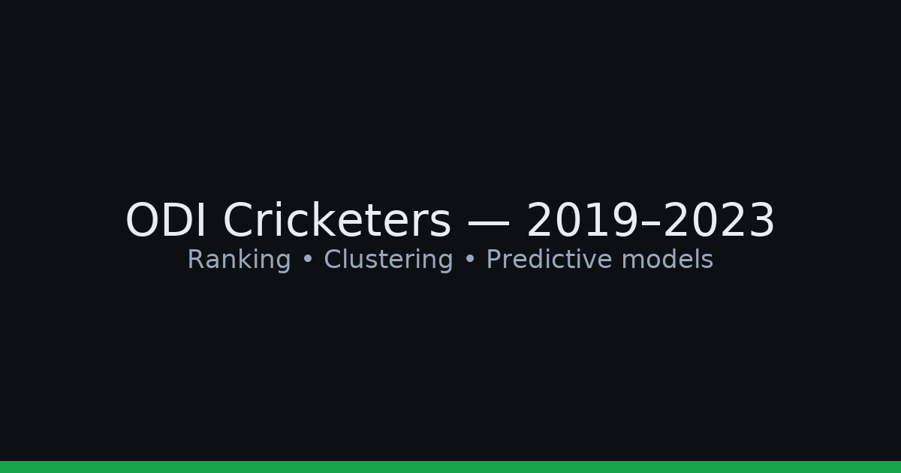

# Statistical Analysis of ODI Cricketers (2019–2023)




**End-to-end analysis of ODI player performance across men's and women's cricket**, using PCA (ranking), clustering (role/skill archetypes), supervised learning (role classification and match-outcome prediction), and MANOVA/ANOVA (country/continent comparisons).

The dataset spans 2019–2023 and covers batting, bowling and fielding metrics. R is the primary stack; Python notebooks are optional.

---

## 🎯 Objectives

- **Rank** batters, bowlers and all-rounders using Principal Component Analysis (PCA)
- **Cluster** players into performance archetypes (hierarchical and k-means)
- **Classify** player roles with SVM, Random Forest, Logistic/Multinomial Regression, Naive Bayes, KNN and Neural Networks
- **Predict** match outcomes (win/loss) and evaluate with ROC/AUC
- **Compare** performance across continents and within Asia using MANOVA/ANOVA
- **Explore associations** (toss → result, batting first → result, home advantage) via odds ratios and contingency analyses

---

## 🧠 Methods Overview

| Area | Techniques |
|---|---|
| Dimensionality reduction / ranking | PCA (loadings, PC scores, biplots) |
| Unsupervised learning | Hierarchical clustering (Ward / complete link), k-means (elbow / silhouette) |
| Supervised learning | SVM, Random Forest, Logistic / Multinomial Regression, Naive Bayes, KNN, Neural Networks |
| Statistical inference | MANOVA / ANOVA, Hotelling's T², 2×2 tables and odds ratios |
| Evaluation | Accuracy, confusion matrices, k-fold cross-validation, ROC/AUC |

---

## 🗂️ Repository Contents

### Scripts (`src/`)

| Task | Scripts |
|---|---|
| PCA rankings | `PCA.R` |
| Clustering (general) | `Cluster.R`, `Heirarchical Clustering.R`, `Heirarchical Clustering1.R` |
| Clustering (men) | `MenKC.R`, `MenKMeansClustering.R`, `MenAsiaHeirarchichalClustering.R` |
| Clustering (women) | `Women K Means Clustering.R`, `WomenKmeansClustering.R`, `WomenCluster1.R`, `WomenAsiaHeirarchichalClustering.R` |
| Role classification | `SVM.R`, `SVM1.R`, `Random Forest Prediction.R`, `Logistic Regression.R`, `Multinomial.R`, `Naive Bayes.R`, `KNN Prediction.R`, `Neural Network.R` |
| Women's classification and features | `Women Classification Techniques.R`, `Women Feature Importance.R` |
| Match outcome prediction | `MatchResultPrediction.R`, `SVMPrediction.R` |
| MANOVA / ANOVA | `MANOVAMEN.R`, `MANOVAWOMEN.R`, `MANOVAASIA.R` |
| Additional inference and validation | `Hotelling Tsquare.R`, `K Fold Cross Validation.R`, `wlb.R` |

### Raw data (`data/raw/`)

| Category | Files |
|---|---|
| Men | `MENCRICKETDATA.csv`, `MenCluster.csv`, `MenbowlerAsia.csv`, `Mentoss.csv` |
| Women | `Womendata.csv`, `women12.csv`, `womenbatting.csv`, `Womenbowling.csv`, `WomenCluster.csv`, `Women Ranking (Batters).csv` |
| Women (Asia / continents) | `WomenAsia.csv`, `WomenAsiaBatsmans.csv`, `WomenbatsmanAsia.csv`, `WomenContinents.csv` |
| Regional and match data | `Asia.csv`, `Aus&NZ.csv`, `Continents.csv`, `Matches.csv` |

---

## 📊 Data & Variables (high level)

- **Scope:** ODI matches from 2019–2023, men's and women's
- **Batting:** innings, runs, balls, average, strike rate, 50s/100s, 4s/6s, dot %
- **Bowling:** overs, runs, wickets, economy, average, strike rate, 5-wicket hauls, dot %
- **Fielding:** catches, stumpings
- **Match meta:** toss, venue/home, result, batting order (first/second)

---

## 🚀 How to Run

### Option A: R (primary)

1. Open R / RStudio and set the working directory to the repo root.
2. Install the packages:

```r
install.packages(c(
  "tidyverse", "ggplot2", "cluster", "factoextra", "randomForest",
  "e1071", "nnet", "class", "MASS", "pROC"
))
```

If a script asks for another package, install it the same way.

3. Run the scripts you need:

| Step | Script(s) |
|---|---|
| PCA rankings | `src/PCA.R` |
| Clustering | `src/Heirarchical Clustering*.R`, `src/*KMeans*.R`, `src/MenKC.R` |
| Role classification | `src/SVM*.R`, `src/Random Forest Prediction.R`, `src/Logistic Regression.R`, `src/Multinomial.R`, `src/Naive Bayes.R`, `src/KNN Prediction.R`, `src/Neural Network.R` |
| Match outcome prediction | `src/MatchResultPrediction.R`, `src/SVMPrediction.R` |
| MANOVA / ANOVA | `src/MANOVAMEN.R`, `src/MANOVAWOMEN.R`, `src/MANOVAASIA.R` |
| Additional inference | `src/Hotelling Tsquare.R`, `src/wlb.R` |

All scripts read inputs from `data/raw/`. Outputs and plots go to `reports/figures/` or `data/processed/` (git-ignored).

### Option B: Python (optional notebooks)

```bash
python -m venv .venv
# Windows: .\.venv\Scripts\activate
# macOS/Linux: source .venv/bin/activate
pip install pandas numpy scikit-learn matplotlib seaborn jupyter
```

Open the notebooks in `notebooks/` and point them to `data/raw/`.

---

## 📈 Outputs

- **Figures:** PCA biplots, dendrograms, k-means clusters, silhouette plots, ROC curves, feature-importance charts
- **Tables:** rankings by role, cluster membership, model metrics, MANOVA/ANOVA summaries, contingency tables and odds ratios

<!--
## 🏆 Key Findings (uncomment and fill in from your results)

- Top-ranked batters / bowlers by PCA: ...
- Number of clusters chosen and what each represents: ...
- Best role-classification model and its accuracy: ...
- Match-outcome model AUC: ...
- Significant continent differences (MANOVA): ...


-->

---

## 🧪 Reproducibility Notes

- Keep raw CSVs unchanged in `data/raw/`.
- Write generated or cleaned data to `data/processed/` (git-ignored).
- Set a random seed (`set.seed()`) where randomness is involved for consistent runs.
- Scripts are modular, so you can run components independently.

---

## 🙌 Acknowledgements

Project work credited to the authors and academic mentors (see the project report). Thanks to public cricket databases for the source data.

## 👤 Author

**Lohith B N** · [Portfolio](https://portfolio-0lzq.onrender.com/) · [LinkedIn](https://www.linkedin.com/in/lohith-b-n/) · [GitHub](https://github.com/Lohithbn12)

## 📄 License

MIT © Lohith B N
